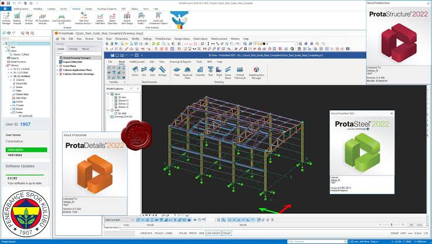
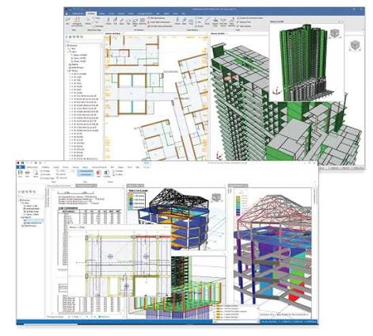
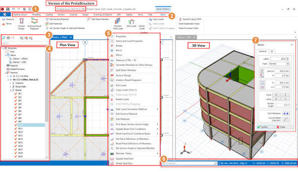

# ProtaStructure Connects Building Models With Design Deliverables

ProtaStructure Suite combines structural modeling, analysis, member design, and drawing production.
Keep the physical model, calculation assumptions, and issued documentation tied to an identifiable revision.

## Give each deliverable an owner and a revision

Before exchanging a model, define what the receiving person needs to review or continue.
A coordination model, an analysis report, and a reinforcement drawing communicate different kinds of information.
Record which model revision produced each output and which changes remain under review.

| Deliverable | Suite component or workflow | Review focus |
| --- | --- | --- |
| Structural model and design results | ProtaStructure | Geometry, assumptions, loads, and member checks |
| Reinforcement details and schedules | ProtaDetails | Agreement with the current concrete design |
| Steel connections and fabrication information | ProtaSteel | Member identity, connections, and drawing consistency |
| Model exchange and coordination | ProtaBIM | Mapping, units, placement, and revision changes |

The [ProtaStructure overview](https://protasoftware.com/products/protastructure/) describes the integrated modeling and design environment.
Select the applicable design-code settings for the project and record the installed product version.
Verify that the required capabilities are available in the chosen edition.

The reference marker [VERSION](VERSION) identifies an IfcOpenShell source version.
A component version should accompany an automated exchange check so its results can be reproduced.

[](https://protastructure-suite.github.io/ProtaStructure/)

## Check exchanged objects before relying on their appearance

An imported solid may look plausible while carrying an unexpected object type, placement, or property assignment.
For a prota structure exchange, compare storeys, grids, member identities, and units with the source model.
Keep a list of elements that require remapping or manual interpretation.

With Python and IfcOpenShell installed, inspect an existing IFC coordination file:

```python
import ifcopenshell
import ifcopenshell.util.unit

model = ifcopenshell.open("coordination.ifc")
print("Schema:", model.schema)
print("Metres per length unit:", ifcopenshell.util.unit.calculate_unit_scale(model))
for kind in ("IfcBuildingStorey", "IfcBeam", "IfcColumn", "IfcSlab"):
    print(kind, len(model.by_type(kind)))
```

The [IfcOpenShell examples](https://docs.ifcopenshell.org/ifcopenshell-python/code_examples.html) describe reading and querying IFC entities.
The [unit utility reference](https://docs.ifcopenshell.org/autoapi/ifcopenshell/util/unit/index.html) defines the scale calculation.
Entity counts help identify exchange differences; they do not establish structural connectivity or design completeness.



The basic I/O cases in [tests.py](test/tests.py) illustrate model-reading checks.
The handler [__init__.py](aws/lambda/example_handler/__init__.py) extracts wall property sets from an IFC file stored in an example S3 workflow.
Its dependency list [requirements.txt](aws/lambda/requirements.txt) names boto3; the handler also imports IfcOpenShell.

## Review the analytical model independently

### Connectivity and load paths

In a protastructure software workflow, inspect the analytical representation after geometry changes or model exchange.
Check member intersections, support conditions, releases, offsets, and the interpretation of slab or wall connections.
Confirm that the applied loads and combinations refer to the intended analysis model.

Use the [ProtaBIM overview](https://protasoftware.com/products/protabim/) to identify the supported exchange and coordination routes.
A physical IFC model and an analytical model serve different purposes; review what each route actually transfers.
Keep unresolved mapping decisions visible in the project record.

### Interpreting a geometry check

A successful geometry conversion establishes that a tool could process that representation.
It does not establish that the structural idealization, loading, or design assumptions are correct.

The smoke test [verify_create_shape.py](pyodide/verify_create_shape.py) checks an extruded solid's generated mesh and dimensions.
The browser test [test_wheel.py](pyodide/test/test_wheel.py) exercises packaged Python code in Pyodide.
The scratch page [inspect.html](docker/inspect.html) helps inspect a native WebAssembly module.
The legacy harness [run.py](test/run.py) describes a rendering-based test workflow using Blender.

## Inspect a shared view without changing the source model

For visual coordination, create a separate representation of the exchanged IFC.
Retain the IFC when object identities and properties must remain available for follow-up.
Keep the visual export beside a note identifying the source revision.

With IfcConvert installed and available on PATH, PowerShell can create a GLB geometry copy:

```powershell
IfcConvert "coordination.ifc" "coordination-view.glb"
```

The [IfcConvert usage reference](https://docs.ifcopenshell.org/ifcconvert/usage) documents conversion by output extension.
Check placement, storey alignment, and conspicuous missing geometry in the receiving viewer.
A GLB copy is for visual review and does not replace the structural calculation model.



The package test [test_occt_plugin_linkage.py](test/package/test_occt_plugin_linkage.py) checks geometry handoffs across plugins.
The loader checks in [test_ifcopenshell_python_shared_libraries.py](test/package/test_ifcopenshell_python_shared_libraries.py) exercise packaged runtime libraries.
The viewer checks in [test_BonsaiViewer_shared_libraries.py](test/package/test_BonsaiViewer_shared_libraries.py) verify that its packaged plugins load.
The checks in [test_package_contents.py](test/package/test_package_contents.py) address missing or duplicated packaged libraries.

## Carry design changes through to drawings

Review member design results before issuing updated reinforcement or steel details.
Track changes to member size, material, reinforcement, connection arrangement, and identifying labels.
Keep drawing revision notes consistent with the calculation and coordination records.

The [ProtaDetails product page](https://protasoftware.com/products/protadetails/) describes concrete detailing and drawing workflows.
The [ProtaSteel product page](https://protasoftware.com/products/protasteel/) describes steel detailing and connection-related tools.
Confirm which changes have propagated to each deliverable rather than assuming every exported file is current.



Before an issue, compare the following against the agreed model revision:

- Member labels and drawing references.
- Storey levels and geometric changes.
- The calculation assumptions associated with the reported results.
- Reinforcement or connection information affected by a design revision.
- The list of outstanding coordination comments.

For browser-based companion tooling, [README.md](pyodide/README.md) explains the Pyodide wrapper build approaches.
The recipe [meta.yaml](pyodide/meta.yaml) defines the package build, while [requirements.txt](pyodide/requirements.txt) pins its build tool.
These references help identify the environment used for an exchange utility.

## Preserve the exchange environment with the issue record

A repeatable prota structure software review needs the source revision, exchange settings, and checking-tool version.
Record what was checked automatically and what required engineering interpretation.
Keep the coordination copy distinct from the model used to calculate and produce design documentation.

The environment guide [README.md](docker/README.md) describes a container-based build setup.
The service definition [compose.yaml](docker/compose.yaml) mounts the source tree and shares a compiler cache.
The helper [ifcos_env](docker/ifcos_env) reads environment settings and manages the build environment.
The Conda package recipe [recipe.yaml](conda/recipe.yaml) records another packaging configuration.
The runner [run_against_package.py](test/package/run_against_package.py) tests packaged artifacts instead of a source-build wrapper.

## Related Search Terms

ProtaStructure Suite, ProtaStructure, prota structure, protastructure software, prota structure software, structural-engineering, structural-analysis, bim, ifc, finite-element-analysis, reinforced-concrete, steel-design, seismic-analysis, detailing, python
